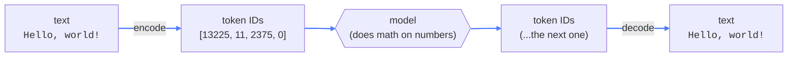

# 01 — Tokenization

## What this is about

**A language model can't read.** It only sees numbers. Tokenization is the translator that turns
your text into numbers the model understands — and turns the model's numbers back into text.

**Think of LEGO.** You can't hand someone a finished castle; you hand them bricks. Text is the
same: it gets chopped into pieces called **tokens**, and every piece gets a number.

Two things this means for you:

- **You pay per token**, not per word or letter. Your bill and your context limit are counted in tokens.
- **The chopping isn't neat.** A common word might be one token; a rare word breaks into several.

## The flow



The model lives in the middle and never sees a single letter.

## The code, piece by piece

```python
import tiktoken

enc = tiktoken.encoding_for_model("gpt-4o")
tokens = enc.encode("Hello, world!")
print(tokens)
print(enc.decode(tokens))
```

**`tiktoken.encoding_for_model("gpt-4o")`** — you pick a *model*, and it gives you that model's
tokenizer. Different models chop text differently, so you always use the matching one. Counting
characters or words yourself never gives the real number.

**`enc.encode("Hello, world!")`** — text in, numbers out:

```
[13225, 11, 2375, 0]
```

`"Hello, world!"` is 13 characters and 2 words — but **4 tokens**. Read one at a time they are
`"Hello"`, `","`, `" world"`, `"!"`. Notice the space is glued onto `world`, and the comma and `!`
get their own tokens.

**`enc.decode(tokens)`** — numbers back to text. It prints `Hello, world!`. `encode` and `decode`
are mirror images: encode to talk to the model, decode to read its reply.

## What you need

```bash
pip install tiktoken
```

One package — OpenAI's tokenizer library. (You can also install everything for the whole repo at
once from the root: `pip install -r requirements.txt`.)

## Run it

```bash
python main.py
```

## Key takeaways

- A model only ever sees **numbers**, never text.
- Tokenization is the translation layer, both ways.
- **Everything is counted in tokens** — cost, speed, and context limits.
- Different models use different tokens. Always use the model's own tokenizer.
