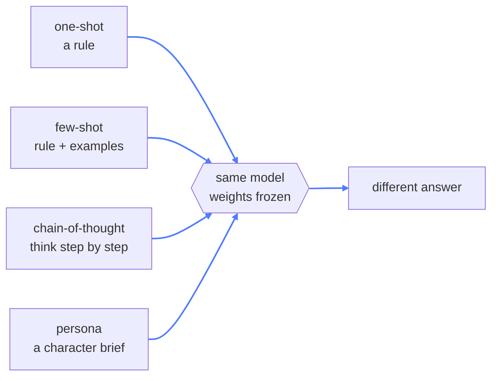
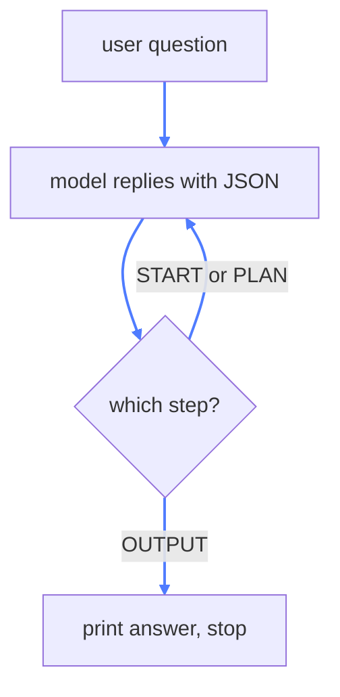

# 02 — Prompt Techniques

## What this is about

The model's brain is **frozen**. You can't retrain it on the spot. The only lever you have is the
words you send it.

**Think of a brilliant new hire on day one.** They know a lot, but they don't know *your* rules
yet. You don't rewire their brain — you talk to them. Prompting is the whole art of getting the
behaviour you want using words alone.

This module shows four ways to do it. They're not a ladder — you pick one, or mix them:



Same model every time. Same one-line question, even. Only the *framing* changes — and the answers
change completely.

## The shared setup

All four files open the same way — a client pointed at a local OpenAI-compatible server:

```python
client = OpenAI(base_url="http://127.0.0.1:1337/v1", api_key="no-key")
```

Nothing here depends on OpenAI specifically. Any OpenAI-compatible endpoint works; only the words
below matter.

## What you need

```bash
pip install openai
```

One package — the `OpenAI` client used by all four files. (The repo root also has
`requirements.txt` with the full stack if you'd rather install everything at once.)

## Run the experiments

```bash
python oneshot.py    # a rule, nothing else
python fewshot.py    # rule + worked examples
python cot.py        # the step-by-step loop, interactive
python persona.py    # the Touka persona
```

---

## 1. One-shot — a single rule (`oneshot.py`)

```python
SYSTEM_PROMPT = "You are a helpful Math assistant. You will help with math problems only. If asked any other problem, you will refuse to answer."
CONTENT = "Hey, I am Ayushya, tell me a joke."
```

One instruction, no examples. The model gets a rule and a question that breaks the rule. This is
the baseline: **a rule alone often leaks** — the model may still drift off-topic when the rule is
only a sentence long.

---

## 2. Few-shot — teach by example (`fewshot.py`)

```python
SYSTEM_PROMPT = """
You are a helpful Math assistant. You will help with math problems only. If asked any other problem, you will refuse to answer.

Examples:
    Q. What is the square root of 16?
    A. The square root of 16 is 4.
    ...
    Q. Tell me a Math joke.
    A. I am sorry, but I can only help with math problems. If you have a math question, please feel free to ask!
"""
```

The rule is identical to one-shot. The difference is the **examples**.

Here's the key insight most people miss: examples don't just show *format* — they show **behaviour**.
Two of the four examples are refusals. The model doesn't learn "here's the answer shape", it learns
"when the topic is wrong, say exactly this". That's what "few-shot" really buys you: you're
demonstrating the outcome you want, not describing it.

> Teaching by example usually beats teaching by rule. People are the same way.

---

## 3. Chain-of-Thought — think before answering (`cot.py`)

**Think of a maths exam.** Students who "show their work" get the right answer far more often than
those who blurt out a number. Chain-of-Thought is prompting the model to show its work.

The prompt forces a tiny state machine, one step per turn:

```
START  → the user's question comes in
PLAN   → (repeatable) reason about the problem, one thought at a time
OUTPUT → the final answer
```

And it demands strict JSON — one object per turn:

```python
{"step": "START" | "PLAN" | "OUTPUT", "content": "string"}
```

### The clever bit: the loop

```python
while True:
    res = client.chat.completions.create(
        model="gemma-4-12B-it-MLX-6bit",
        response_format={"type": "json_object"},
        messages=message_history,
    )
    raw_res = res.choices[0].message.content
    message_history.append({"role": "assistant", "content": raw_res})
    parsed_res = json.loads(raw_res)

    if parsed_res["step"] == "OUTPUT":
        print(f"🤖 {parsed_res['content']}")
        break
```

Each reply is fed back into the history, then the model is called again. The **model itself
decides when it's done** by returning `OUTPUT`. That's a reasoning loop, not a single call.



Two details worth noticing:

- `response_format={"type": "json_object"}` is doing real work — without it, `json.loads` would
  crash on the model's chattier prose.
- The `json.loads` + `while` combo is the seed of every agent loop you'll write later. This is a
  model driving its own control flow.

---

## 4. Persona — give it a whole character (`persona.py`)

A one-line role ("you are a math assistant") is a label. A **persona** is a full brief: identity,
tone, expertise, and rules about what to do when the request doesn't fit.

```python
SYSTEM_PROMPT = """
<|im_start|>system
You are Touka, a distinguished historian and historical researcher. Your expertise spans ancient, medieval, and modern world history...
- Identity: Articulate, analytical, intellectually curious...
- Avoid Anachronisms: Evaluate historical figures within the realities of their own eras...
- Scope: ...politely pivot back to historical analysis.
```

Two things make this file interesting:

**1. It's persona *and* few-shot in one.** Look at the raw chat-template tokens (`<|im_start|>`).
The author has hand-written example turns — a Bronze Age question answered in depth, and a "write my
Python tax code" question politely refused and redirected — right inside the system message. So the
model sees a character *and* worked examples of how that character behaves.

**2. The refusal is a pivot, not a wall.** Where the math assistant just says "sorry, I only do
math", Touka redirects: *"if you're interested in the evolution of taxation itself... I'd be
delighted to..."*. Same safety, much better experience.

> Note the trade-off: clamping scope tightly (module 1's assistant) can make a model refuse even
> harmless things — it'll decline to tell a joke or suggest a movie. Focus and flexibility pull
> against each other.

---

## Key takeaways

- You steer a frozen model with **words alone** — framing is the whole game.
- **One-shot:** a bare rule. Cheap, but easy to ignore.
- **Few-shot:** rule + examples. Examples teach *behaviour*, which is stronger than any description.
- **Chain-of-Thought:** make it show its work; a `loop + JSON` here becomes the agent loop later.
- **Persona:** a full character brief, often with baked-in examples — the deepest control, and the
  friendliest refusals.
