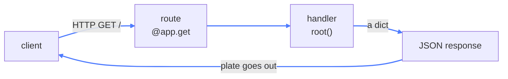
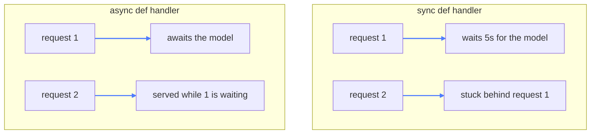

# 03 — FastAPI

## What this is about

A Python script only runs on your machine. Nothing else can reach it. To let a website, a phone
app, or another agent use your model, you have to turn it into an **HTTP service**.

**Think of a restaurant.** Your model is the kitchen. The API is the menu and the waiter. Customers
never walk into the kitchen — they order from the menu, the waiter carries it in, and a plate comes
back out. FastAPI is that front-of-house: it takes orders (requests), routes them to the right
cook (handler), and serves the plate (JSON).

This module is the smallest possible restaurant: one menu item, one plate.



---

## The code, piece by piece

```python
from fastapi import FastAPI

app = FastAPI()

@app.get("/")
async def root():
    return {"message": "BANKAI!"}
```

**`app = FastAPI()`** — creates the application object. This is the thing the server runs. Every
route you define hangs off it.

**`@app.get("/")`** — a *route*. Two pieces of information: the HTTP **method** (`get`) and the
**path** (`/`). A browser hitting `http://127.0.0.1:8000/` triggers this function. `get` is for
reading; `post` is for sending data in (you'll see that below).

**`async def root()`** — the handler. The `async` keyword matters a lot for AI work — see
[Why `async` matters](#why-async-matters) below.

**`return {"message": "BANKAI!"}`** — you return a plain Python dict. FastAPI turns it into JSON
and sets `Content-Type: application/json` for you. You never touch serialization.

## What you need

```bash
pip install fastapi uvicorn openai
```

- **fastapi** — the web framework itself
- **uvicorn** — the server that actually runs it
- **openai** — only used by the `POST /chat` route
- **pydantic** — comes automatically with fastapi, no separate install

(As everywhere in this repo, `pip install -r requirements.txt` from the root installs it all.)

## Run it

```bash
uvicorn server:app --reload
```

`server:app` means "the `app` object inside `server.py`". Then open `http://127.0.0.1:8000`.

## Every endpoint in `server.py`

Once you add the techniques below, the file holds five routes. Here's each one with a `curl` you
can paste straight into a terminal, and the response it actually returns:

| Route | What it demonstrates |
| --- | --- |
| `GET /` | The minimal handler — return a dict, get JSON |
| `GET /users/{user_id}` | Path parameter, type conversion, and a `404` |
| `GET /items` | Query parameters with defaults |
| `POST /ask` | Pydantic request body + validation |
| `POST /chat` | The same body, forwarded to a real LLM |

```bash
curl http://127.0.0.1:8000/
# {"message":"BANKAI!"}

curl http://127.0.0.1:8000/users/42
# {"user_id":42}

curl http://127.0.0.1:8000/users/abc        # 422 — FastAPI rejects it, you wrote no check
# {"detail":[{"type":"int_parsing", ...}]}

curl "http://127.0.0.1:8000/items?skip=20&limit=5"
# {"skip":20,"limit":5}

curl -X POST http://127.0.0.1:8000/ask \
     -H 'Content-Type: application/json' \
     -d '{"text":"hello","temperature":0.2}'
# {"received":"hello","temperature":0.2}
```

`/chat` needs your local model server running on `127.0.0.1:1337` — without it you'll get a `500`,
which is the connection failing, not the route being wrong.

---

## The free stuff nobody mentions

Define that one route and you already have:

| URL | What you get |
| --- | --- |
| `/docs` | **Swagger UI** — interactive docs where you can *call* your API from the browser |
| `/redoc` | The same API as clean reference docs |
| `/openapi.json` | The machine-readable schema other tools consume |

None of that is written by you. FastAPI generates it from your routes and your **type hints**.
That's the real reason to pick it over a bare Flask app: the types are the documentation.

---

## Going further — the four things every API needs

The 7 lines above are the skeleton. Here's the rest of the tutorial.

### 1. Path parameters — data in the URL

```python
@app.get("/users/{user_id}")
async def get_user(user_id: int):
    return {"user_id": user_id}
```

The `{user_id}` in the path is captured and passed to the function. Note the `: int` — FastAPI
**converts and validates** it. Request `/users/42` and you get the integer `42`. Request
`/users/abc` and you get an automatic `422` error explaining the problem. You wrote no checks.

### 2. Query parameters — the `?` part

```python
@app.get("/items")
async def list_items(skip: int = 0, limit: int = 10):
    return {"skip": skip, "limit": limit}
```

Any function argument *not* in the path becomes a query parameter: `/items?skip=20&limit=5`. The
defaults make them optional.

### 3. Request body — sending real data in

This is how you'd accept a prompt:

```python
from pydantic import BaseModel

class Prompt(BaseModel):
    text: str
    temperature: float = 0.7

@app.post("/ask")
async def ask(p: Prompt):
    return {"received": p.text}
```

Declare a **Pydantic model** as a parameter and FastAPI does four things at once: parses the JSON
body, validates every field, rejects bad input with a clear `422`, and documents the expected
shape in `/docs`. One class, four wins.

> **Pydantic gets its own full tutorial in the next module.** Here it's only doing input
> validation. In module 04 we put it to much stronger use — forcing the *model itself* to emit
> output that matches a schema, so you parse objects instead of strings.

### 4. Status codes and errors

```python
from fastapi import HTTPException

@app.get("/users/{user_id}")
async def get_user(user_id: int):
    if user_id == 0:
        raise HTTPException(status_code=404, detail="user not found")
    return {"user_id": user_id}
```

Raising `HTTPException` is how you return a proper error instead of a `200` with an apology inside
the JSON.

---

## Why `async` matters

This is the part that makes FastAPI the default choice for AI services.

An LLM call takes **seconds**. A normal function blocks during that time — the whole worker sits
idle, and every other request queues up behind it. An `async def` handler *awaits* the call, and
while it waits the event loop is free to serve someone else.



Rule of thumb: use `async def` when the handler awaits I/O (an LLM, a database, another API). Use
plain `def` for pure CPU work — FastAPI runs those in a threadpool so they don't block either.

---

## Tying it back to AI

Here's module 02's prompting, exposed as a service. Same client, now reachable by anything:

```python
from openai import AsyncOpenAI

client = AsyncOpenAI(base_url="http://127.0.0.1:1337/v1", api_key="no-key")

@app.post("/chat")
async def chat(p: Prompt):
    res = await client.chat.completions.create(
        model="gemma-4-12B-it-MLX-6bit",
        temperature=p.temperature,
        messages=[{"role": "user", "content": p.text}],
    )
    return {"answer": res.choices[0].message.content}
```

Notice `await` on the model call — that's the async payoff in practice.

It's a separate route from `/ask` on purpose: two handlers can't share the same method and path.
Everything above — all five endpoints — lives in `server.py`.

**One problem remains**, and it's the whole point of module 06: this request holds the connection
open for the full duration of the LLM call. Add real retrieval on top and clients start timing out.
The fix is to hand the work to a background queue and return a job ID immediately.

---

## Key takeaways

- A script is private; an **API is how other things reach your model**.
- A route = **method + path + handler**. Return a dict, get JSON.
- **Type hints do the heavy lifting** — validation, conversion, errors, and docs all come from them.
- `/docs` is free. Use it to test endpoints instead of writing curl commands.
- **`async def` is not decoration.** With multi-second LLM calls, it's the difference between one
  user at a time and many.
- This 7-line shape is the template every later service in this repo follows.
