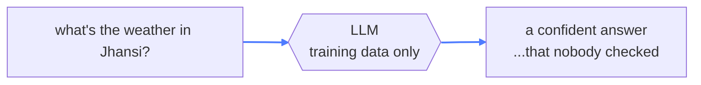
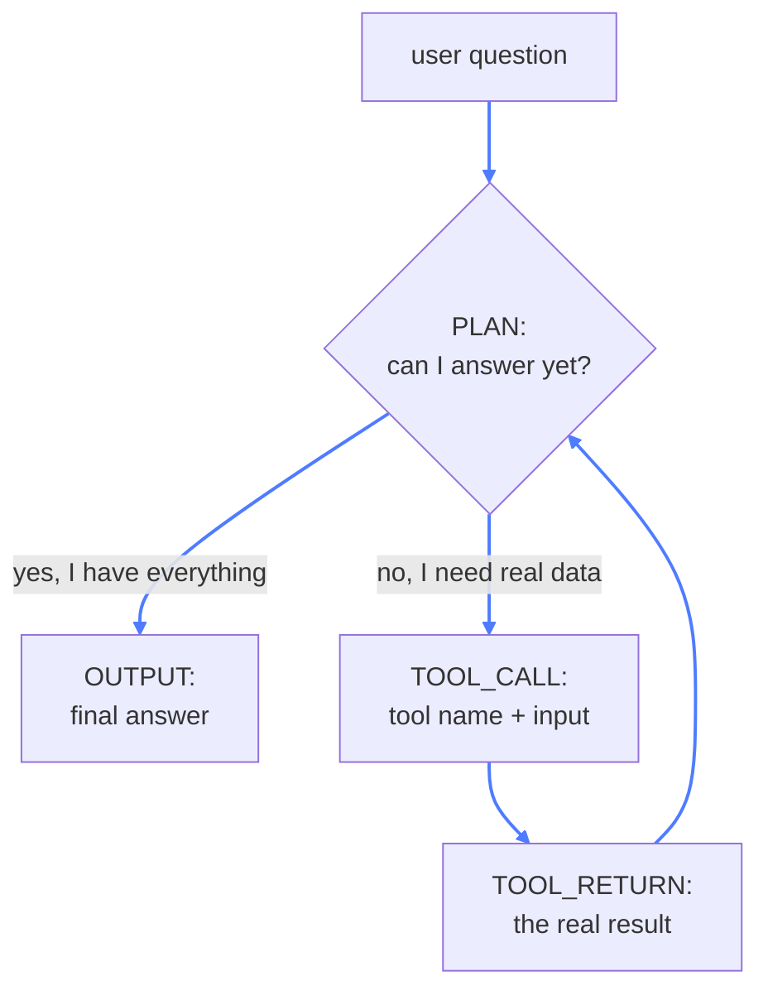
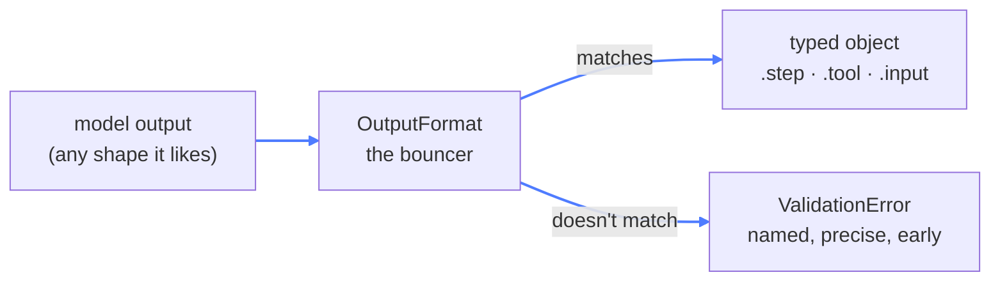

# 04 — Weather Agent

## What this is about

Module 02 gave the model a persona. This module gives it **hands**.

**Think of a brilliant friend who has read every book ever printed — but has no phone.** Ask them
about the Bronze Age, perfect answer. Ask them the weather in Jhansi right now, and they'll guess
confidently. Not because they're dumb — because the answer *doesn't exist in their head*.

This module is in three versions, and they're meant to be read in order:

| File | What it is | The lesson |
| --- | --- | --- |
| `main.py` | plain chatbot | the model guesses live data |
| `agent.py` | tool-calling loop | the model learns to *ask for help* |
| `structured_output.py` | same loop, Pydantic-validated | you stop trusting strings |

## What you need

```bash
pip install openai requests pydantic python-dotenv
```

- **openai** — the client talking to the model
- **requests** — fetching real weather from `wttr.in`
- **pydantic** — schema-validated model output (the big tutorial below; it also installs automatically with openai)
- **python-dotenv** — loads `.env` for `structured_output.py`

Add a `.env` in the repo root with a line like `GEMINI_API_KEY=whatever` — `structured_output.py`
reads it via `load_dotenv()`. (Or install everything at once with `pip install -r requirements.txt`.)

---

## 1. The baseline — and the problem it exposes (`main.py`)

```python
def get_weather(city: str):
    url = f"https://wttr.in/{city.lower()}?format=%C+%t"
    response = requests.get(url)
    ...

def main():
    user_query = input("User >>> ")
    response = client.chat.completions.create(
        model="gemma-4-12B-it-MLX-6bit",
        messages=[{"role": "user", "content": user_query}],
    )
    print(f"Sasha >>>: {response.choices[0].message.content}")
```

Look closely: **`get_weather` is right there — and nothing ever calls it.** It's dead code, and
it's dead *on purpose*. It exists to prove a point:



The model can't reach the internet. It can only *sound* like it did.

---

## 2. The agent loop (`agent.py`)

A chatbot answers. An **agent** can act. The trick: the model can't run code, but it *can write a
request to run code* — and your Python does the running.

The whole thing is one state machine, driven by the model itself:



Same START/PLAN/OUTPUT shape as module 02, plus two steps. Walk the loop:

### The tool registry

```python
avail_tools = {
    "get_weather": get_weather,
}
```

A plain dict: tool *name* → actual Python function. The model can only say names; this dict is
what makes those names real. The prompt tells it what exists:

```
Available tools:
    - get_weather(city: str): returns the current weather in the given city.
```

### The handoff moment

```python
if parsed_res["step"] == "TOOL_CALL":
    tool = parsed_res["tool"]
    tool_input = parsed_res["input"]

    tool_func = avail_tools[tool]
    tool_res = tool_func(tool_input)

    message_history.append({"role": "developer", "content": json.dumps({
        "step": "TOOL_RETURN", "tool": tool, "input": tool_input, "content": tool_res,
    })})
    continue
```

Read it slowly, because this *is* the agent pattern:

1. The model's JSON says *"run get_weather on jhansi"* — it ran nothing.
2. Your code looks the name up in `avail_tools` and **executes** it.
3. The result goes back into `message_history` as a `TOOL_RETURN` message.
4. `continue` loops the conversation back to the model, which now has the real data.

Two loops matter here. The **inner** `while True` runs one reasoning chain until `OUTPUT`. The
**outer** one wraps it so the conversation continues after each answer.

> Notice the model never *did* anything. It wrote a proposal; your loop is the executor. That
> split — model decides, code acts — is the entire architecture of every agent framework you'll
> meet later. LangGraph, MCP, all of it is this loop wearing different clothes.

---

## 3. Structured output with Pydantic (`structured_output.py`)

Version 2 works — but look at what it's built on: `json.loads(raw_res)` then
`parsed_res["step"]`. You're parsing **strings you asked a language model to produce**. One
malformed response and it's a `KeyError` at 2am.

Pydantic fixes that. Same loop, three upgrades:

```python
from pydantic import BaseModel, Field
from typing import Optional

class OutputFormat(BaseModel):
    step: str = Field(..., description="START, PLAN, OUTPUT, or TOOL_CALL")
    content: Optional[str] = Field(None, description="text for this step")
    tool: Optional[str] = Field(None, description="tool name when step is TOOL_CALL")
    input: Optional[str] = Field(None, description="argument for the tool")

res = client.chat.completions.parse(
    model="gemma-4-12B-it-MLX-6bit",
    response_format=OutputFormat,
    messages=message_history,
)
parsed_res = res.choices[0].message.parsed
```

Three changes from `agent.py`:

- `create` → **`parse`**, with `response_format=OutputFormat` (the *class*, not a dict)
- `json.loads` → **`message.parsed`** (a validated object, already)
- `parsed_res["step"]` → **`parsed_res.step`** (attribute access, type-checked)
- `avail_tools[tool]` → **`avail_tools.get(tool)`** (an unknown tool returns an error message
  instead of crashing the loop)

And a fourth: the tool list gains `run_cmd`, which can execute Linux commands on your machine.
More on that in [A safety note](#a-safety-note) below.

---

## Pydantic in three minutes

**Pydantic is the bouncer at the door of your program.** Raw data queues up outside — API
responses, model output, user input. The bouncer has one list: your class definition. Data either
matches it and walks in as a clean, typed object — or it's turned away with an exact reason why.

### The class *is* the schema

```python
from pydantic import BaseModel, Field
from typing import Optional

class OutputFormat(BaseModel):
    step: str = Field(..., description="START, PLAN, OUTPUT, or TOOL_CALL")
    content: Optional[str] = Field(None)
```

Piece by piece:

- **`BaseModel`** — inherit from it and every class attribute becomes a validated field.
- **`step: str`** — the type annotation is the validation rule. Not a string? Rejected.
- **`Field(...)`** — the `...` (Ellipsis) means *required*; there is no default, so the field must
  be provided.
- **`Field(None)`** — `Optional[str] = None` means the field may be absent.
- **`description=`** — human-readable docs *and*, when you hand the model to the API as a
  response format, these descriptions are sent along as instructions. The schema is your prompt.

### See the bouncer work

```python
OutputFormat(step="TOOL_CALL", tool="get_weather", input="jhansi")   # walks in
o = OutputFormat(step="PLAN", content="thinking...")
o.step        # "PLAN"      — typed attribute, autocomplete works
o.tool        # None        — absent, not a KeyError

OutputFormat(step=123)        # ValidationError — rejected at the door
OutputFormat()                # ValidationError — 'step' is required
```

`ValidationError` is the point: bad data **fails fast and loudly at the boundary**, instead of
drifting quietly into your logic and blowing up three functions later.

### How it reaches the model



`parse()` sends the class's JSON schema to the API, so the *server* constrains generation to your
shape. Compare the two modes:

| `create` + `json_object` | `parse` + Pydantic |
| --- | --- |
| guarantees *valid JSON* | guarantees *your exact schema* |
| you get a string | you get a typed object |
| `json.loads` + manual checks | validation happens for you |
| `KeyError` risk deep in your loop | `ValidationError` right at the boundary |

---

## A safety note

`run_cmd` is a loaded gun left on the table:

```python
def run_cmd(cmd: str):
    result = subprocess.run(cmd, shell=True, text=True, capture_output=True)
    ...
```

Whatever the model decides is a good idea gets executed in **your shell, with your permissions**.
Ask it to clean up disk space and it may pick something destructive. This is fine as a learning
demo; it is not fine in production. Module 16 (Guardrails) exists precisely to close this hole —
human approval before the tool fires, allow-lists, scoped permissions.

---

## Key takeaways

- A model can't fetch live data — it can only **ask you to**, and that's enough.
- The agent loop is a **state machine the model drives**: PLAN until it needs a tool, call it,
  read the result, continue. Your code executes; the model decides.
- A tool registry is just a **dict of name → function**. The prompt is its user manual.
- `json.loads` on model output is trust. **Pydantic turns trust into a contract**: define the
  schema once, get typed objects, fail fast on garbage.
- `Field(..., description=...)` is documentation for you and **instructions for the model**.
- And a taste of what's coming: give an agent shell access, and you'll want guardrails.
