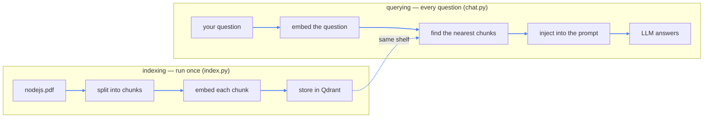
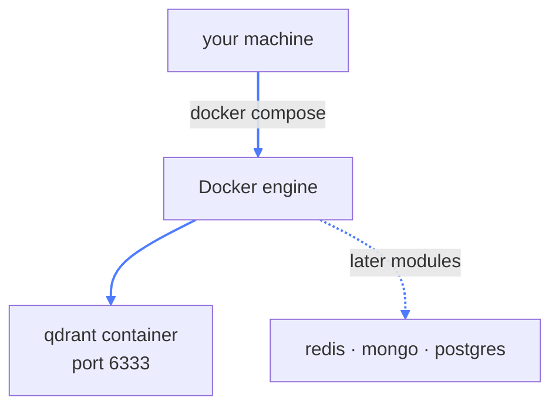

# 05 — RAG (Retrieval-Augmented Generation)

## What this is about

So far the model could only answer from its **training data**. Ask it about *your* PDF and it
guesses. RAG fixes that the way a student fixes an open-book exam:

> **Don't memorize the book. Learn where to look it up, then answer with the book open.**

The LLM reads a few relevant pages *at question time* and answers from those. That's the whole
idea — everything in this module exists to make that lookup fast and accurate.

## The big picture

Two separate pipelines. **Index once**, query forever:



## What you need

```bash
pip install langchain-community langchain-text-splitters langchain-huggingface \
            langchain-qdrant pypdf openai python-dotenv
```

- **langchain-community + pypdf** — loading the PDF
- **langchain-text-splitters** — cutting it into chunks
- **langchain-huggingface** — running a small local embedding model
- **langchain-qdrant** — talking to the vector database
- **openai + python-dotenv** — the LLM client (same as earlier modules)

Then start the database (next section). Or install everything at once: `pip install -r requirements.txt`.

---

## Docker in five minutes

**Why is Docker here at all?** Because Qdrant is a *database server*, and you don't pip-install
databases — you run them. Docker lets you run Qdrant in a sealed box instead of installing it
onto your machine.

**Think of a shipping container.** Whatever goes inside travels anywhere and works the same. A
Docker container packs Qdrant with everything it needs, so it runs identically on your machine,
your friend's laptop, or a cloud server. When you're done, you delete the whole thing in one
command — no leftovers in your system.

That's the actual answer to "why Docker": **isolation, identical environments, and instant
disposal.** Every later module in this repo leans on this (Redis, Mongo, Postgres, Neo4j — all
via the same trick).

### The file, line by line

```yaml
services:
  vector-db:
    image: qdrant/qdrant
    ports:
      - "6333:6333"
```

- **`services:`** — each entry is one container this file should run.
- **`vector-db:`** — the name *you* pick; it's how you refer to it.
- **`image: qdrant/qdrant`** — the prebuilt blueprint, downloaded from Docker Hub. No install, no compiling.
- **`ports: "6333:6333"`** — read it as `host:container`. Traffic hitting **your** machine's port
  6333 is forwarded into the container's port 6333. This one line is why Python talks to
  `http://localhost:6333` while the database actually lives inside a sealed box.



### The four commands you need

```bash
docker compose up -d      # start it, in the background
docker compose ps         # confirm it's running
docker compose logs -f    # watch its logs
docker compose down       # stop it and remove the container
```

---

## The indexing pipeline (`index.py`)

Four steps: load → split → embed → store.

### 1. Load the PDF

```python
loader = PyPDFLoader(pdf_path)
docs = loader.load()
```

This gives you **one document per page**, each carrying metadata: the page number and the file
it came from. Hold onto that — it's why the chatbot can later say *"see page 7"*. The model
isn't quoting page numbers from memory; they ride along as metadata.

### 2. Split into chunks

```python
text_splitter = RecursiveCharacterTextSplitter(
    chunk_size=1000,
    chunk_overlap=200,
)
chunks = text_splitter.split_documents(docs)
```

**Why split at all?** A 400-page PDF is far bigger than the model's context window. You can't
feed the whole book into the prompt — you feed the *few relevant pages*. To find those pages
precisely, you cut the text into small pieces.

- **`chunk_size=1000`** — each piece is at most 1000 characters.
- **`chunk_overlap=200`** — consecutive pieces share 200 characters:

```
|-- chunk 1 (1000 chars) --|
                    |-- chunk 2 (1000 chars) --|
          ^^^^^ 200 chars shared ^^^^^
```

**Why overlap?** Imagine a sentence that straddles the 1000-character mark. Without overlap it's
chopped in half — and a half-sentence retrieved from either chunk is useless. With overlap, the
full sentence survives intact in at least one chunk. It's the difference between cutting a film
at scene boundaries versus mid-dialogue.

**Why "Recursive"?** It doesn't chop at character 1000 blindly. It first tries to split on
paragraphs, then sentences, then words — always preferring the cut that keeps meaning together.

### 3. Turn text into vectors (embeddings)

**Think of a meaning map.** Every piece of text gets GPS coordinates on a map of *meaning*.
"KBK college" and "Kanhaiyalal Bakliwal educational institute" share no words — but on the
meaning map they're practically neighbors. That's the superpower: **search by meaning, not by
keywords.**

```python
model = HuggingFaceEmbeddings(
    model_name="sentence-transformers/all-MiniLM-L6-v2",
    model_kwargs={"device": "mps"},
    encode_kwargs={"normalize_embeddings": True},
)
```

- **`all-MiniLM-L6-v2`** — a small, fast, free model that runs **locally** (no API key, your PDF
  never leaves the machine). Each text becomes a **384-number vector**.
- **`device: "mps"`** — Apple Silicon GPU. On Linux use `"cuda"`, on any machine `"cpu"` also works.
- **`normalize_embeddings: True`** — shrinks every vector to length 1. After that, comparing
  vectors reduces to measuring the **angle** between them — pure similarity, independent of text
  length.

> **The one rule of RAG:** index and query must use the **same embedding model**. Each model has
> its own coordinate system — mix two and you're pinning locations from a London map onto a New
> York grid. Your question will land in the ocean.

### 4. Store in Qdrant

```python
vector_store = QdrantVectorStore.from_documents(
    documents=chunks,
    embedding=model,
    url="http://localhost:6333",
    prefer_grpc=False,
    collection_name="learning_rag",
)
```

`from_documents` embeds every chunk and pushes text + vector + metadata into Qdrant, all in one
call. **Qdrant** is the vector database — a warehouse built for one job: *give me a vector, I'll
return the nearest ones*. A regular database finds exact matches; Qdrant finds *close* ones.

- **`prefer_grpc=False`** — use the plain HTTP API (port 6333) rather than the faster gRPC port (6334).
- **`collection_name`** — like a table name; you can keep many documents in one Qdrant.

---

## The query pipeline (`chat.py`)

### Reconnect, don't re-index

```python
vector_db = QdrantVectorStore.from_existing_collection(
    embedding=model,
    url="http://localhost:6333",
    collection_name="learning_rag",
)
```

Same embedding model, same collection name — just a connection to the shelf that `index.py`
already filled.

### The retrieval + answer loop

```python
while True:
    user_query = input("🤖 Hey, How can I help you with today?\n")

    res = vector_db.similarity_search(user_query)
    context = "\n\n\n".join([
        f"Page Content: {doc.page_content}\nPage Number: {doc.metadata['page']}\nFile Location: {doc.metadata['source']}"
        for doc in res
    ])

    SYSTEM_PROMPT = f"""
    You are a helpful assistant. You answer question based on the available context,
    retrieved from a pdf file along with page_contents and page number.
    ...
    Context:
    {context}
    """
```

Walk through one turn:

1. **`similarity_search(user_query)`** — embeds your question with the *same* model, then asks
   Qdrant for the nearest chunks. Default is **k=4**: the four closest pieces of the book.
2. **Build the context** — each hit is formatted with its content, page number, and source.
3. **Inject into the system prompt** — the f-string stuffs the retrieved text *into the prompt
   itself*. This is the "R" and the "A" of RAG happening in three lines.
4. The LLM answers **only from that context** — and points you to the page to read more.

Notice what the model never does: it never sees the PDF, never searches, never remembers. Each
turn is a fresh question with a fresh handful of pages stapled to it. (No memory across turns —
that's exactly what module 08 adds.)

> **This prompt pattern is the anti-hallucination move.** By confining the model to "answer from
> the context", you've traded "anything it ever read" for "these four chunks I can verify". That
> trade is the entire value of RAG.

---

## Key takeaways

- **RAG = retrieve, then generate.** The model reads the relevant pages at question time instead
  of pretending to know.
- **Embeddings are coordinates on a meaning map** — similar meaning lands nearby, so search by
  meaning, not keywords.
- **Chunking makes retrieval precise**; overlap keeps cut-in-half ideas intact somewhere.
- **Same embedding model at index time and query time** — or nothing works.
- **Qdrant stores vectors and finds neighbors**; Docker gives you that database in a disposable box.
- The retrieved chunks go straight **into the prompt** — grounding is just prompt engineering
  with fetched context.
