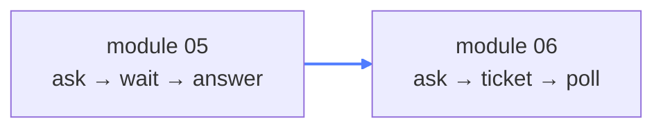
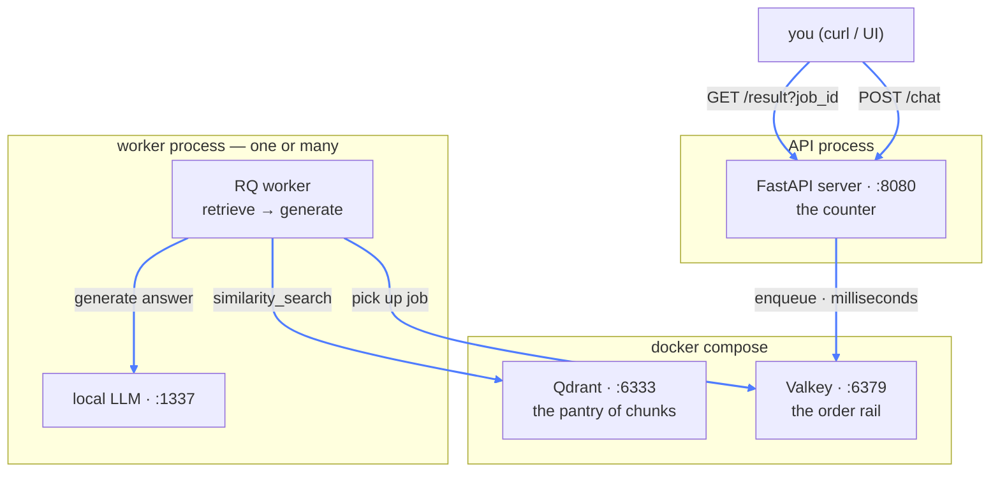
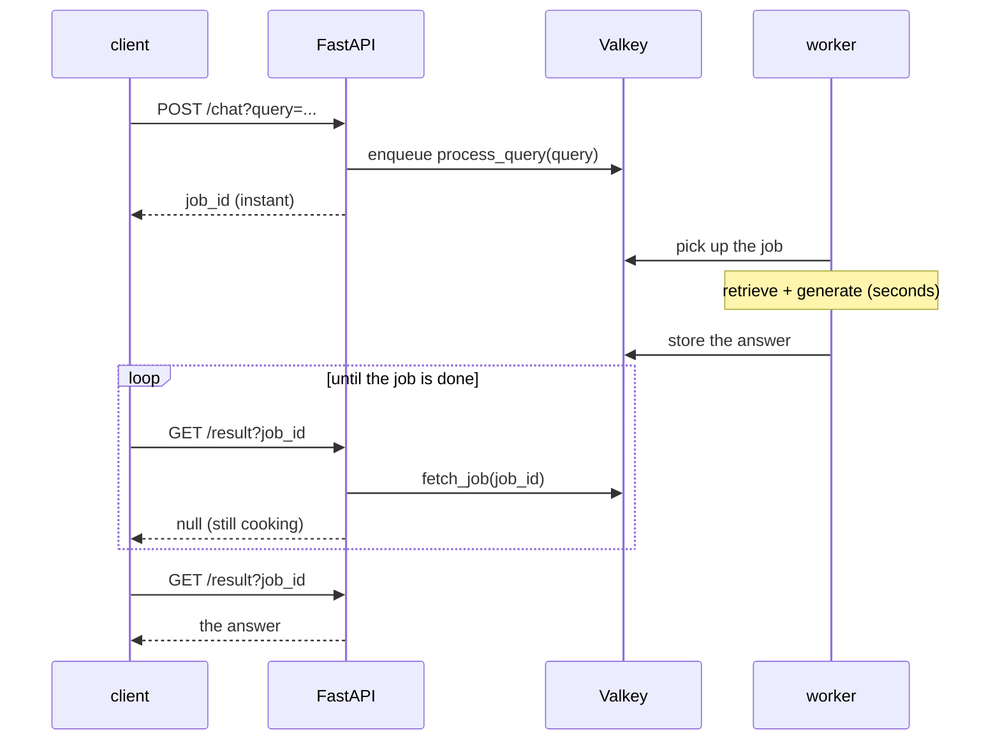

# 06 — RAG Queue

## What this is about

Module 05 has a hidden problem: **the HTTP request does all the work.** While you embed, search,
and generate, the connection stays open — seconds per question. One slow request holds a worker
hostage, a burst of users piles up, and if the process dies mid-request, the work is simply lost.

**Think of a coffee shop.** Module 05 makes you stand at the counter, staring at the barista,
until your drink is done. This module gives you a **buzzer**: you order, take a seat, and go pick
it up when it buzzes. The barista works the queue at their own pace — and the shop can hire more
baristas without changing the counter.

That's a **job queue**: submit the work, get a ticket, poll for the result.



## Architecture

Four separate moving parts. This is the first module where the pieces genuinely matter, so here's
the whole system:



Key idea: the API process **never** touches the LLM or Qdrant. It only writes a ticket to the
rail and reads answers back. The heavy lifting lives in a completely separate process.

## What you need

```bash
pip install rq redis fastapi uvicorn openai \
            langchain-community langchain-text-splitters \
            langchain-huggingface langchain-qdrant pypdf
```

New faces since module 05: **rq** (the queue library) and **redis** (the client that talks to
Valkey). Everything else is the RAG stack you already know. This folder also carries its own
`queues/requirements.txt` with fully pinned versions. Or: `pip install -r requirements.txt` from
the repo root.

---

## Docker, round two — two services this time

```yaml
services:
  valkey:
    image: valkey/valkey:latest
    ports:
      - "6379:6379"

  vector_db:
    image: qdrant/qdrant:latest
    ports:
      - "6333:6333"
```

Same pattern as module 05, now with **two containers from one file** — that's the real payoff of
Docker Compose: describe the whole setup once, `docker compose up -d`, and both databases are
running with the right ports mapped.

**What's Valkey?** An open-source fork of Redis (same creator, same commands, same protocol).
RQ speaks the Redis protocol, so it can't tell the difference — you get Redis-compatible behavior
without Redis's licensing drama. Inside this module, "the queue" and "Valkey" mean the same thing.

---

## The three files

### 1. `client/rq_client.py` — the queue handle

```python
queue = Queue(connection=Redis(host="localhost", port=6379))
```

**RQ (Redis Queue)** turns a Redis database into a job queue: jobs go in one side, workers pull
them off the other. `Queue(...)` with no name means the `"default"` queue. This tiny object is
the order rail — both the server and the worker connect to it.

### 2. `server.py` — the counter

```python
@app.post("/chat")
def chat(query: str = Query(..., description="The user's query")):
    job = queue.enqueue(process_query, query)
    return {"status": "queued", "job_id": job.id}

@app.get("/result")
def get_job_status(job_id: str = Query(...)):
    job = queue.fetch_job(job_id)
    if job is None:
        return {"status": "not found"}
    return {"status": job.return_value()}
```

Two endpoints, and the whole pattern is in them:

- **`queue.enqueue(process_query, query)`** — note: `process_query` with **no parentheses**. You
  pass the function itself, not its result. RQ serializes a *reference* to it plus the arguments,
  writes a job record into Redis, and hands back a `job.id` — in milliseconds. That instant
  `{"status": "queued", "job_id": ...}` is the buzzer.
- **`Query(..., description=...)`** — the `...` marks the parameter required, exactly like
  `Field(...)` in module 04's Pydantic section.
- **`job.return_value()`** — the answer once the job is done, and `None` while it's still
  cooking. That's why the poll returns `{"status": null}` and then suddenly the text. (A
  production version would also report `queued` / `failed` via `job.get_status()` — this one is
  minimal on purpose.)

### 3. `queues/worker.py` — the kitchen

Two distinct parts:

**Boot-time work** — runs once, when the worker process starts:

```python
pdf_path = Path(__file__).parent / "nodejs.pdf"
docs = PyPDFLoader(pdf_path).load()
chunks = text_splitter.split_documents(docs)

vector_db = QdrantVectorStore.from_documents(
    embedding=model, url="http://localhost:6333",
    collection_name="learning_rag", documents=chunks,
    check_compatibility=False,
)
```

This is module 05's entire indexing pipeline — load, chunk, embed, store — executed the moment
the worker boots, not per request. Pay the cost once, then every query only does retrieval +
generation. (`check_compatibility=False` skips a version check between the qdrant client and the
stored collection.)

**Per-job work** — the function RQ calls:

```python
def process_query(query: str):
    res = vector_db.similarity_search(query)          # the "R"
    context = "\n\n\n".join([...])                    # build the prompt
    resp = client.chat.completions.create(...)        # the "G"
    return resp.choices[0].message.content
```

Same RAG loop as module 05 — the only difference is *who calls it*: not the HTTP handler, but a
worker that picked the job off the rail.

> Why does the worker live in its own `queues/` package? Because RQ stores the job as a *path* —
> `queues.worker.process_query`. When a worker picks the job up, it imports the function by that
> path. The code must live somewhere importable from both processes, which is exactly what the
> package layout gives you.

---

## One request's journey



The API answered twice — instantly with a ticket, later with the result. Between those two calls,
the connection was closed and nobody was waiting on anything.

## Run it — three terminals

```bash
docker compose up -d     # terminal 1: Valkey + Qdrant
rq worker                # terminal 2: the kitchen (from this folder)
python main.py           # terminal 3: the counter, on :8080
```

`rq worker` must run from `06_RAG_queue/` — it needs `queues.worker` to be importable. Watch it
load, chunk, and embed the PDF on startup; that's the boot-time indexing.

Then:

```bash
curl -X POST "http://127.0.0.1:8080/chat?query=what+is+event+loop"
# {"status":"queued","job_id":"5f3a..."}

curl "http://127.0.0.1:8080/result?job_id=5f3a..."
# {"status":null}          ← still cooking, poll again

curl "http://127.0.0.1:8080/result?job_id=5f3a..."
# {"status":"The event loop is ..."}   ← done
```

---

## Why this scales

- **The API is cheap now.** Every request is a millisecond Redis write — it can absorb a storm of
  users while one worker grinds through the backlog.
- **Work survives crashes.** A job sits in Redis until a worker claims it. Worker dies? Restart
  it; the job is still there.
- **Scaling is one command.** Open a terminal, run `rq worker` again — now there are two
  kitchens. RQ guarantees each job is claimed by exactly one worker, so you just add more until
  the backlog drains. No code changes.
- **This is horizontal scaling**, the thing that actually holds up in production: stateless
  workers pulling from a shared queue.

## Key takeaways

- **Decouple submission from processing**: enqueue + poll instead of hold-the-connection.
- The queue (Valkey/Redis) is the handoff point between a **cheap API** and **expensive work**.
- **Enqueue a function reference** — no parentheses — and get a `job_id` back in milliseconds.
- Do expensive setup (indexing) **at worker boot**, per-request work in the job function.
- More throughput = more worker processes pulling from the same rail. That's the whole scaling story.
