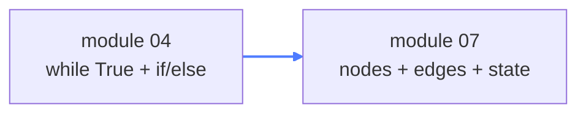
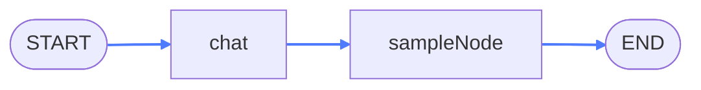
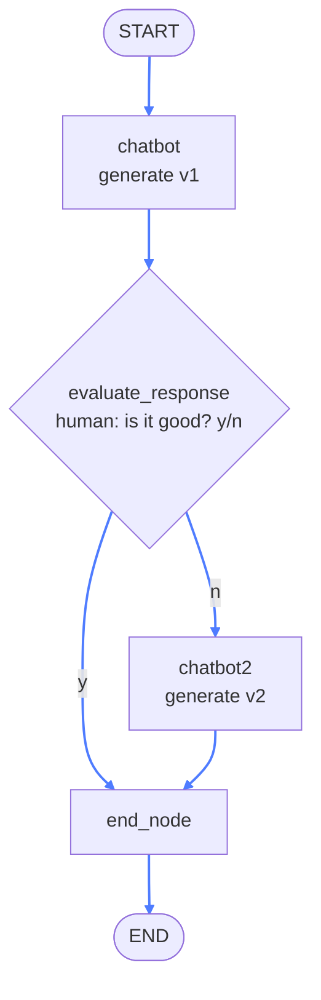

# 07 — LangGraph

## What this is about

Modules 02 and 04 built agent loops by hand: a `while True`, some `if` checks on a JSON field, a
`message_history` list. It works — until the logic grows. Ten steps and three branches later,
it's a wall of nested conditions that no one can draw on a whiteboard.

**LangGraph's idea: make the flowchart of the program itself.** You draw a graph — boxes and arrows —
and each box is just a Python function. The framework runs the arrows for you.

**Think of a railway.** Your data is the train, each station is a **node**, and the tracks are
**edges**. A **junction** (conditional edge) has a switch operator who decides which track the
train takes next. That's the entire vocabulary: state, nodes, edges, conditional edges.



## What you need

```bash
pip install langgraph openai
```

(LangGraph is the only new package — everything else you've met. Or `pip install -r requirements.txt`.)

---

## The minimal graph (`chat.py`)

Three ingredients: a state shape, node functions, and wiring.

### The state — and the twist in it

```python
class State(TypedDict):
    messages: Annotated[list, add_messages]
```

- **`TypedDict`** — just a dict with type hints. The state is ordinary data passed from node to node.
- **`Annotated[list, add_messages]`** — this is the important line. Nodes return *partial updates*,
  and LangGraph has to merge them into the state. The default merge for a list would be
  **overwrite**. `add_messages` changes the rule for this key to **append**.

### Nodes return updates, not the whole state

```python
def chat(state: State):
    return {"messages": ["Hey there new message"]}
```

A node receives the current state and returns only what it wants to **change**. LangGraph applies
that update using the rule from `Annotated`. So after `chat` runs, `messages` still contains the
original "Hi, my name is Ayushya" — with this new message added after it.

### Wiring and running

```python
graph_builder = StateGraph(State)
graph_builder.add_node("chat", chat)
graph_builder.add_node("sampleNode", sampleNode)

graph_builder.add_edge(START, "chat")
graph_builder.add_edge("chat", "sampleNode")
graph_builder.add_edge("sampleNode", END)

graph = graph_builder.compile()
updated_state = graph.invoke({"messages": ["Hi, my name is Ayushya"]})
```

Every arrow is one line. `compile()` turns the drawing into a runnable object; `invoke()` pushes
your input into `START` and returns the **final state** when the train reaches `END` — which, thanks
to `add_messages`, is the full accumulated history:



Trivial? Yes — deliberately. The point is the vocabulary: state schema, nodes, edges, partial
updates, reducers. Everything else in LangGraph is this plus smarter arrows.

---

## Conditional routing (`smart_routing.py`)

Now the arrow that decides. This graph generates an answer, **asks a human** whether it's good,
and regenerates if not — the graph version of module 04's retry loop.



### The state this time

```python
class State(TypedDict):
    user_query: str
    llm_output: Optional[str]
```

`Optional` because before `chatbot` runs, there is no output yet. Plain fields like this are
**overwritten** by each node — only keys with a reducer in `Annotated` accumulate.

### The conditional edge — a function, not a node

```python
def evaluate_response(state: State) -> Literal["chatbot2", "end_node"]:
    if input("Is the response good? (y/n)\n") == "y":
        return "end_node"
    return "chatbot2"

builder.add_conditional_edges("chatbot", evaluate_response)
```

Read this carefully — it's the concept of the module:

- `evaluate_response` is **not a node**. It runs *between* nodes, after `chatbot` finishes.
- It inspects the state and **returns the name of the next node** — here as a `Literal` type so
  typos are caught statically.
- `add_conditional_edges("chatbot", ...)` attaches it to the arrow leaving `chatbot`. The switch
  operator stands at the junction, not on the train.

Note where the decision comes from: `input()` — a **human in the loop**. The graph structure
doesn't care whether the switch is flipped by a person, a regex, or a second LLM call. (Both
options arrive in module 16, as guardrails.)

### The rest is plain edges

```python
builder.add_edge(START, "chatbot")
builder.add_edge("chatbot2", "end_node")
builder.add_edge("end_node", END)
```

`chatbot2` regenerates and always flows into `end_node` — a fixed track. `graph.invoke(...)` runs
the whole thing and returns the final state, printed at the bottom.

---

## Hand-rolled loop → graph, side by side

Everything you built manually in modules 02–04 has a name in LangGraph:

| You hand-rolled | LangGraph calls it |
| --- | --- |
| `message_history.append(...)` | the `add_messages` **reducer** on state |
| `if parsed["step"] == "PLAN": continue` | **edges** between nodes |
| your step-dispatch `if/else` chain | **conditional edges** |
| the `while True` loop itself | the graph — cycles are just edges that point backwards |
| passing `message_history` into every call | the **state**, threaded through automatically |

The loop didn't disappear — it became a *drawing*. And a drawing can be inspected, extended, and
reasoned about in a way nested `if`s can't.

> One step ahead: reducers are also what make **parallel** nodes safe. If two nodes append to the
> same list at once, a merge rule like `add_messages` decides the outcome instead of one
> overwriting the other. That's exactly the trick module 15 uses to fan a query out to several
> agents and merge their answers.

## Key takeaways

- **LangGraph = an executable flowchart**: state flows through nodes along edges.
- Nodes return **partial updates**; the `Annotated[key, reducer]` line decides how each field merges.
- **Conditional edges** are functions between nodes that return the next node's name — the graph's `if`.
- Cycles (retry, self-improvement) are just edges pointing backwards — no `while` needed.
- The decision behind a conditional edge can be **a human**, a rule, or a model. The graph doesn't care.
- Your hand-rolled agent loop now has a formal shape you can extend instead of rewrite.
