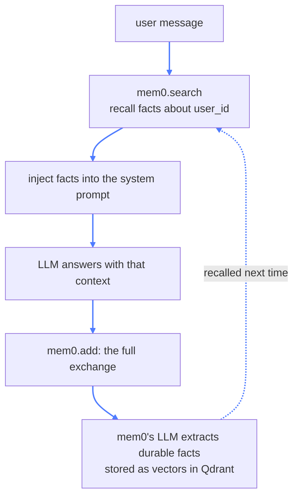

# 09 — AI Agents Memory (mem0)

## What this is about

Module 08 gave the agent a memory, but look at what it remembers: **everything, verbatim**. A
tape recorder. Ten conversations later, the context window is stuffed with every "hi" and every
typo, and the model still has to wade through it to find what matters.

**Real memory isn't a transcript — it's notes.** Think of a good friend. You've told them a
hundred things over the years; they don't remember your sentences, they remember *you*: where you
live, what you're working on, that you hate cilantro. Small talk evaporates; facts stick.

That's what **mem0** adds: a memory layer that **extracts durable facts** from conversations,
stores them, and recalls only the relevant ones later. Long-term, semantic, per-user memory that
lives *outside* the context window.

### The loop



Recognize the shape? **It's RAG** (module 05) — search, inject, generate — except the "documents"
are facts extracted from this user's past conversations.

## What you need

```bash
pip install mem0ai openai
```

Plus Docker for Qdrant (same as module 05): `docker compose up -d`. Or
`pip install -r requirements.txt` from the repo root.

---

## The config — three brains

```python
config = {
    "version": "v1.1",
    "embedder": {
        "provider": "huggingface",
        "config": {"model": "sentence-transformers/all-MiniLM-L6-v2"},
    },
    "llm": {
        "provider": "openai",
        "config": {
            "model": "gemma-4-12B-it-MLX-6bit",
            "openai_base_url": "http://127.0.0.1:1337/v1",
            "api_key": "not-needed",
        },
    },
    "vector_store": {
        "provider": "qdrant",
        "config": {
            "host": "localhost",
            "port": 6333,
            "collection_name": "mem0_minilm",
            "embedding_model_dims": 384,
        },
    },
}

mem_client = Memory.from_config(config)
```

Every part is something you've met — assembled into a memory layer:

- **`embedder`** — the *same* `all-MiniLM-L6-v2` from modules 05/06. Facts become 384-dimension
  vectors so they can be searched by meaning, exactly like PDF chunks were.
- **`llm`** — here's the twist worth pausing on: **the memory layer needs its own brain.** Who
  decides which parts of a conversation are worth keeping? An LLM call. mem0 is agentic on the
  inside — every `.add()` spends a model call on *judgment*, not just storage.
- **`vector_store`** — Qdrant again, but a *separate collection* (`mem0_minilm`). Memories and
  documents live apart. `embedding_model_dims: 384` must match the embedder — the one-rule-of-RAG
  from module 05 applies here too.

## The loop, piece by piece

### 1. Recall

```python
search_mem = mem_client.search(query=user_query, filters={"user_id": "ken"})
```

Before answering, search the memory store for facts **relevant to this specific question**, about
**this specific user**. The `user_id` filter is the boundary between people — mem0's version of
module 08's `thread_id`, but scoped to a *person* rather than a *chat*.

### 2. Inject

```python
SYSTEM_PROMPT = f"""
    Here is the context about the user:
        {json.dumps(search_mem)}
"""
```

The recalled facts ride into the system prompt — same grounding trick as RAG. The model never
"remembers" anything; it *reads* what the memory layer fetched.

### 3. Answer, then write back

```python
res = client.chat.completions.create(...)
ai_res = res.choices[0].message.content

mem_client.add(
    messages=[
        {"role": "user", "content": user_query},
        {"role": "assistant", "content": ai_res},
    ],
    user_id="ken",
)
```

`.add()` is where the magic lives. The full exchange goes in — and mem0's LLM decides what's
durable:


Greetings, filler, and "thanks!" get dropped; facts get deduplicated against existing memories and
stored as vectors. The friend quietly updating their notes after every chat.

---

## Short-term vs long-term, side by side

| | Module 08 (checkpointing) | Module 09 (mem0) |
| --- | --- | --- |
| What's stored | every message, verbatim | extracted facts only |
| Grows | with every message | curated — mostly stays small |
| Recalled | whole history, in order | only what's relevant to the question |
| Scope key | `thread_id` — one chat | `user_id` — one person |
| Needs a database? | yes (Mongo) | yes (Qdrant) — same persistence for free |
| Used for | continuity within a conversation | knowing the user across conversations |

They're not rivals — real agents use **both**: checkpoints for the current chat, semantic memory
for everything the user ever taught you.

## Run it

```bash
docker compose up -d     # Qdrant on :6333
python mem.py
```

The experiment, and it survives restarts because memories live in Qdrant, not RAM:

```
>>> My name is Ken, I live in Delhi, and I prefer short answers.
... answer ...
>>> Memory Synced

>>> Where do I live?
```

Watch the `Mem found:` line — the second question recalls the first conversation's facts, even in
a brand-new process.

## Key takeaways

- **Verbatim history is short-term memory; extracted facts are long-term memory.**
- The memory loop is **RAG over your own conversations**: recall → inject → generate → write back.
- **The memory layer itself uses an LLM** — deciding what's worth remembering is a judgment call,
  and judgment needs a brain.
- `user_id` partitions memory per person, like `thread_id` did per chat.
- Memories are **vectors in a vector store** — searchable by meaning, persistent across restarts.
