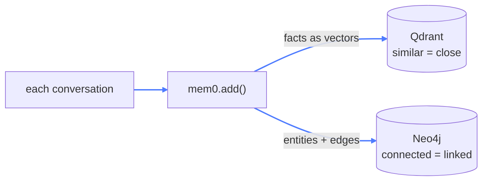
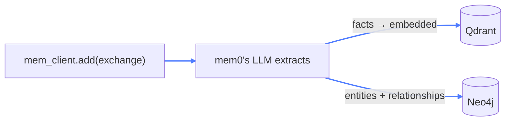
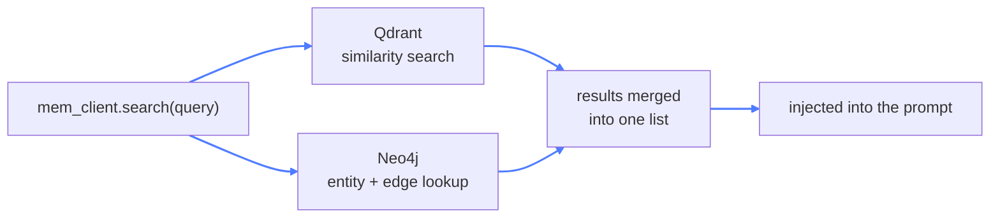
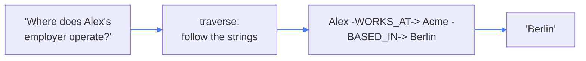
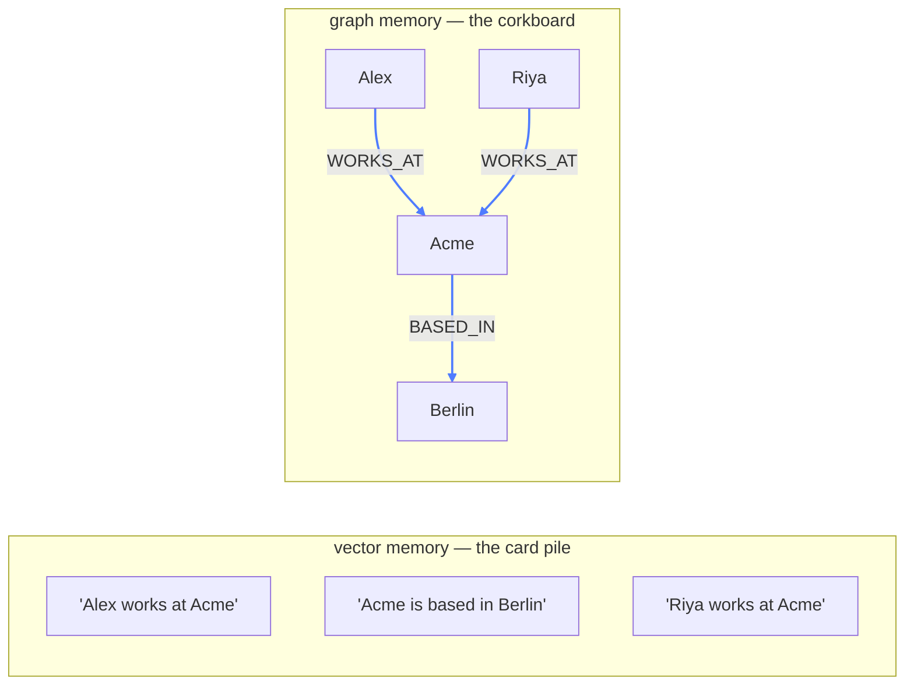

# 10 — Graph Memory

## What this is about

Module 09's memory has a blind spot it took us one module to hit: **vectors know what's *similar*,
not what's *connected*.**

Store *"Alex works at Acme"* and *"Acme is based in Berlin"* as vectors. Now ask: *"Where does
Alex's employer operate?"* There's no stored sentence containing "Alex" and "Berlin" — the answer
is *between* two facts. Similarity search finds both cards; **connecting them is your problem.**

**Vector memory is a pile of index cards.** Any card is findable if a new question "feels like"
it — but cards don't point at each other.

**Graph memory is a detective's corkboard.** Photos pinned up, red string between the ones that
relate. *Alex* —string→ *Acme* —string→ *Berlin*. Follow the string, and multi-hop questions
answer themselves.

That's what **Neo4j** adds here: memory as **entities and relationships** — nodes and edges, not
just similarity scores.

## What you need

```bash
pip install mem0ai openai neo4j
```

**Infrastructure is different in this module:**

```bash
docker compose up -d     # brings up Qdrant only
```

Look at the compose file — **no Neo4j service**. This module uses a hosted **Neo4j AuraDB**
instance instead of a local container. Its coordinates come from `.env` (see the repo root's
`.env.example`):

```
NEO_USERNAME=...
NEO_PASSWORD=...
NEO_URI=neo4j+s://<your-instance>.databases.neo4j.io
CMD_API_KEY=...            # for the hosted LLM gateway this module points at
```

(You *could* run Neo4j in Docker the same way as Qdrant — the point of using Aura here is that a
graph DB you'll query from anywhere is nicer hosted. Or `pip install -r requirements.txt` for all
Python deps.)

---

## The config — the same loop, one new store

The config from module 09, with one addition:

```python
"graph_store": {
    "provider": "neo4j",
    "config": {
        "username": os.getenv("NEO_USERNAME"),
        "password": os.getenv("NEO_PASSWORD"),
        "url": os.getenv("NEO_URI"),
        "database": "60c9da61",
    },
},
```

- `database: "60c9da61"` is the AuraDB instance ID — each cloud database gets one.
- The vector store stays exactly as module 09 had it (Qdrant, MiniLM, 384 dims).
- The LLM endpoint differs from module 09 — a hosted gateway via `CMD_API_KEY` — but that's
  plumbing, not concept. Any OpenAI-compatible endpoint works.

Here's the whole point of this module in one diagram — **`mem0.add()` now writes to two stores**:



### Not a replacement — and not a third brain

Be precise about the roles, because this is the question everyone asks first:

- **mem0 is not being replaced** — it's the memory *layer*: the orchestrator. It owns the LLM
  judgment (what's worth keeping), the API (`add` / `search`), and both stores underneath.
- **Neo4j does not replace Qdrant** — they do different jobs:

| Store | Question it answers | Fails at |
| --- | --- | --- |
| Qdrant (vectors) | *"which stored facts **feel similar** to this question?"* | connecting facts together |
| Neo4j (graph) | *"what is **connected** to what?"* | fuzzy, "kind of like this" lookups |

**They work side by side, and the config is what wires it:** declaring *both* a `vector_store` and
a `graph_store` makes `Memory.from_config` build both, and every memory operation then fans out to
the two of them.

**Write path** — one call, two writes:



**Read path** — one call, two queries, one merged answer:



So every memory exists **twice, on purpose**: as a floating point on the meaning-map and as a pin
on the corkboard — and each question is answered by whichever store fits it. You never chose
between them; you chose *both*.

---

## The loop — deliberately identical

```python
search_mem = mem_client.search(query=user_query, user_id="alex")
...
res = client.chat.completions.create(...)
...
sync_result = mem_client.add(messages=[...], user_id="alex")
```

Read it next to `09/mem.py`: same recall → inject → generate → write-back. That's the point —
**the agent's code didn't change; the memory layer's internals did.** That's the payoff of having
a memory *layer* at all.

Two small, honest differences to notice while reading:

- `search(query, user_id="alex")` instead of module 09's `filters={"user_id": ...}` — mem0's
  search API changed across versions, and both call shapes are commented in the file. This repo
  pins `mem0ai==1.0.11` (pre-2.0), so this is the correct one.
- The `sync_result` is printed — do this once and look inside: alongside the vector results you'll
  see the graph relations it created, e.g. Alex → `works_at` → Acme. That printout is the module's
  proof.

---

## Why graphs win: the multi-hop question

Recall the question vectors couldn't answer. On the corkboard, it's a walk:



No stored sentence ever contained the answer. It was **inferred by traversing two edges** — the
kind of reasoning similarity search cannot do, no matter how good the embeddings are.

### The two stores, side by side



| Ask about... | Vector memory | Graph memory |
| --- | --- | --- |
| "What does Alex do for work?" | finds the card, easy | finds the edge, easy |
| "Where does Alex's employer operate?" | two cards, **you** connect them | **traverses** WORKS_AT → BASED_IN |
| "Who else works with Alex?" | fuzzy at best | walks the same WORKS_AT edge backwards |
| "What's similar to this note?" | **its home turf** | awkward — graphs aren't for fuzzy matching |

**So: graphs for relationships and multi-hop inference; vectors for fuzzy semantic lookup.** They
complement, and mem0 writes both so each question can use the right tool.

## Run it

```bash
docker compose up -d     # Qdrant
python main.py           # Neo4j is remote — comes from .env
```

```
>>> My name is Alex and I work at Acme.
...
>>> Acme is based in Berlin.
...
>>> Where does my employer operate?
```

Then open the **Neo4j Aura console** and run `MATCH (n)-[r]->(m) RETURN n, r, m` — you'll see the
corkboard mem0 has been pinning for you.

## Key takeaways

- **Vector memory recalls what's similar; graph memory stores what's related.**
- Facts become **triples** — entity, relationship, entity — and live as nodes and edges in Neo4j.
- **Multi-hop answers come from traversal**, not similarity — reasoning across edges is something
  embeddings structurally cannot do.
- mem0 writes **both** stores from one `.add()` — the agent code never changes.
- Keep both: **vectors for fuzzy search, graphs for connected reasoning.**
