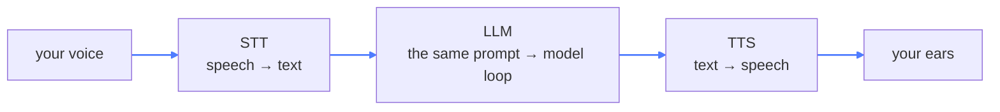
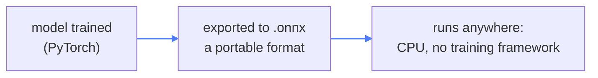

# 11 — Voice Agents

## What this is about

Every agent so far talked through a **keyboard**. This module gives it **ears and a mouth** — and
that's all it adds.

**Think of a UN translator booth.** The speaker in the booth can't hear the room and can't speak
to it — they have an earpiece and a microphone. Your LLM is that brilliant booth speaker: it can
neither hear nor talk. This module bolts on both:



The insight that keeps this module calm: **the model never touches audio.** Speech becomes text on
the way in, text becomes speech on the way out. In between it's the exact loop from module 02.
This is a **multimodal pipeline** — one brain, two modality wrappers.

## What you need

```bash
pip install kokoro-onnx sounddevice soundfile SpeechRecognition PyAudio openai python-dotenv
```

- **SpeechRecognition + PyAudio** — the ears (PyAudio is the microphone binding)
- **kokoro-onnx + soundfile** — the mouth (a local neural TTS model)
- **sounddevice** — plays the generated audio
- **openai + python-dotenv** — the brain (as always)

Plus the model weights — large files, downloaded once, kept next to `main.py` (and kept out of
git):

```bash
cd 11_Voice_agents

# TTS model
curl -L -O https://github.com/thewh1teagle/kokoro-onnx/releases/download/model-files-v1.0/kokoro-v1.0.onnx

# Voice pack
curl -L -O https://github.com/thewh1teagle/kokoro-onnx/releases/download/model-files-v1.0/voices-v1.0.bin

cd ..
```

You'll also need `CMD_API_KEY` / `CMD_BASE_URL` in `.env` for the LLM gateway. And say hello to the
macOS microphone-permission dialog on first run. (Or `pip install -r requirements.txt` from the root.)

---

## The ears — `stt()`

```python
def stt() -> str:
    r = sr.Recognizer()

    with sr.Microphone() as source:
        r.adjust_for_ambient_noise(source)
        r.pause_threshold = 2

        print("\n>>> Listening...\n")
        audio = r.listen(source)
        text = r.recognize_google(audio)
        print(f"\n>>> You said: {text}\n")

        return text
```

Four small decisions that make it usable:

- **`adjust_for_ambient_noise(source)`** — listens briefly *before* you speak to calibrate what
  "silence" sounds like in your room. Without it, a fan or traffic counts as words.
- **`pause_threshold = 2`** — two seconds of silence ends the recording. This is the "I think
  you're done talking" rule. Too short and it cuts you off mid-breath; too long and every pause
  feels like a hang-up.
- **`listen()`** — records until that silence threshold is hit. One utterance per call.
- **`recognize_google(audio)`** — sends the audio to Google's free Web Speech API and returns
  text. Note the asymmetry with the mouth: **the ears are in the cloud, the mouth is local.**

## The mouth — `tts()`

```python
def tts(text: str | None) -> None:
    if text is None:
        return
    kokoro = Kokoro(MODEL_PATH, VOICES_PATH)
    samples, sample_rate = kokoro.create(
        text,
        voice="af_sarah",
        speed=1.0,
        lang="en-us",
    )
    sd.play(samples, sample_rate)
    sd.wait()
```

- **Kokoro** is a small neural TTS model that runs **entirely on your machine** — no API, no
  keys, no per-character billing. It takes text and returns raw audio **samples** (numbers, tens
  of thousands per second) plus the **sample rate** needed to play them back.
- **`voice="af_sarah"`** — Kokoro ships a pack of voices in `voices-v1.0.bin`; this picks one.
  Same text, different mouth.
- **`sd.play(...)` then `sd.wait()`** — push the samples to your speakers, and crucially *wait*
  until playback finishes before returning — otherwise the program exits and cuts itself off
  mid-sentence.

### Why ".onnx"? — models as portable files



ONNX is to models what a PDF is to documents: a trained model gets exported once, and then anyone
can *run* it without the original training stack. That's why this module needs two files —
`kokoro-v1.0.onnx` (the brain of the mouth) and `voices-v1.0.bin` (its accent) — and no GPU.

## The brain — same loop, new costume

```python
def main():
    text = stt()
    response = client.chat.completions.create(
        model="deepseek/deepseek-v4-flash",
        messages=[{"role": "user", "content": text}],
    )
    tts(response.choices[0].message.content)
```

No state, no tools, no memory — one turn per run: hear, think, speak. Every capability from
earlier modules could slot in here unchanged.

But one thing *did* have to change — the **system prompt**:

```
You are an expert voice agent. You will be given a transcript of the user's audio...
give a response in such a way like you are speaking naturally. Your transcribed text
will be used to convert back to the voice and given to the user...
```

This is prompt engineering for the **mouth**, not the eye. Written-LLM habits (bullet lists,
markdown, "Here's what you can do:") sound ridiculous read aloud:

| A written reply | The same reply, spoken |
| --- | --- |
| `1. Open the File menu.` | `"First, open the File menu..."` |
| `**Note:** requires Python 3.11` | `"One thing to know — you'll need Python three eleven."` |
| a markdown table | a sentence |

The model is told its text will be *spoken*, so it writes sentences instead of documents.

## Key takeaways

- A voice agent = **STT → LLM → TTS** — a multimodal pipeline around the same prompt → model loop.
- The model only ever sees **text**; audio is converted at both ends.
- STT tuning is about **turn-taking**: calibrate the noise floor, then define how long silence
  means "you're done".
- **Local TTS via ONNX** — trained models exported as portable files that run anywhere, no GPU.
- **The system prompt now writes for the ear** — spoken-style sentences, not markdown documents.
- Asymmetry is normal in production too: the ears may be cloud-hosted while the mouth runs locally.
