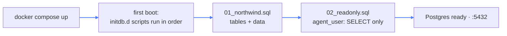

# 12 — SQL Analyst

## What this is about

The capstone agent: **tool calling over a real database.** Module 04 taught the model to ask for
tools; this module hands it a live PostgreSQL — and the interesting problems that come with it:

- The model has **no idea what tables exist** — it must *discover* the schema before it can write SQL.
- The model **writes broken SQL sometimes** — it must read the error and retry, not give up.
- Databases are **dangerous** — a hallucinated `DELETE` would be a very bad day.

**Think of a brilliant analyst's first day at a company whose filing system they've never seen.**
You don't hand them the master key. You give them a **floor plan** (`list_tables`), a guide to
each cabinet (`describe_tables`), and a **badge that opens drawers but can't modify anything**
(read-only credentials). The badge is the safety; the floor plan is the workflow.

The database is **Northwind** — the classic Microsoft sample company (orders, customers, products,
shippers — see `ER.png` for the entity map). 3,900 lines of seed SQL, loaded automatically.

## What you need

```bash
pip install langchain langchain-openai sqlalchemy psycopg2-binary python-dotenv
```

- **langchain + langchain-openai** — the tool-calling agent framework
- **sqlalchemy + psycopg2-binary** — the Python-to-Postgres connection
- **python-dotenv** — reads `POSTGRES_URL`, `CMD_API_KEY`, `CMD_BASE_URL` from `.env`

Then: `docker compose up -d` (Postgres + pgAdmin, fully seeded on first boot). Or
`pip install -r requirements.txt` from the repo root.

---

## How the database boots itself

The compose file is worth reading — the database **seeds and locks itself down on first start**:

```yaml
volumes:
  - postgresql_data:/var/lib/postgresql/data
  # 1. Populates the database first
  - ./01_northwind.sql:/docker-entrypoint-initdb.d/01_northwind.sql:ro
  # 2. Applies the read-only user lockdown
  - ./02_readonly.sql:/docker-entrypoint-initdb.d/02_readonly.sql:ro
```

Anything mounted into `/docker-entrypoint-initdb.d` runs **once, on first boot, in alphabetical
order** — that's why the files are numbered `01_` and `02_`: data first, lockdown second. The
`:ro` suffix mounts them read-only; scripts can't be tampered with from inside the container.
The named volume keeps the data alive across restarts (module 08's trick again).



(Second service: **pgAdmin** on `:5050` — a web UI to browse the same database. Login
`admin@admin.com` / `admin`, add a server with host `db`, user `postgres`, password
`postgres_admin_password`.)

---

## The tools — `main.py`

Three small functions wrapped with LangChain's `@tool` decorator:

```python
@tool
def list_tables() -> list[str]:
    """Fetches all table names in the public schema."""
    query = text("""
        SELECT table_name
        FROM information_schema.tables
        WHERE table_schema = 'public'
          AND table_type = 'BASE TABLE';
    """)
    result = conn.execute(query)
    return [row[0] for row in result.fetchall()]
```

Details that matter:

- **The docstring is the tool description.** That's what the model reads when deciding which tool
  to call — same idea as module 04's prompt listing, but attached to the function itself.
- These queries hit `information_schema` — Postgres's built-in catalog *about* the database.
  Discovery means querying the metadata, not guessing.

### `describe_tables` — see one cabinet

```python
@tool
def describe_tables(table_name: str) -> dict:
    """Describes the columns and sample data of a given table."""
    query = text("""
        SELECT column_name, data_type
        FROM information_schema.columns
        WHERE table_name = :table_name;
    """).bindparams(table_name=table_name)
    ...
    sample_result = conn.execute(text(f"SELECT * FROM {table_name} LIMIT 2;"))
```

Two things to notice, one good and one worth knowing:

- **`:table_name` is a bound parameter** — the value travels separately from the SQL, so the model
  can't break out of the query. The other interpolation (`FROM {table_name}`) is an *identifier* —
  SQL can't parameterize those, so it stays an f-string. The trust boundary: the name comes from
  `list_tables`, and the DB user can only `SELECT` anyway (below).
- **`LIMIT 2` sample rows** — the model doesn't just learn column *names*, it sees what the data
  actually looks like. Real values prevent hallucinated column formats.

### `exec_sql` — errors are data, not crashes

```python
@tool
def exec_sql(sql: str) -> str:
    """Executes a SQL query and returns rows or an error message."""
    try:
        result = conn.execute(text(sql))
        return str([list(row) for row in result.fetchall()])
    except Exception as e:
        return f"Database Error: {str(e)}"
```

The `try/except` is **deliberate design**: a failed query returns the error text *to the model*
instead of raising. That's what makes the prompt's "Error Recovery" step possible — the agent
reads `column "custmor_id" does not exist`, checks the schema, fixes the typo, and retries on its
own. Errors as input, not exceptions.

---

## The agent loop — now by framework

Everything module 04 hand-rolled, LangChain does here:

| Module 04 (hand-rolled) | Module 12 (LangChain) |
| --- | --- |
| `avail_tools` dict | `tools = [list_tables, describe_tables, exec_sql]` |
| tool-call JSON parsing | handled by `create_tool_calling_agent` |
| the `while` loop feeding results back | `AgentExecutor` |
| scratchpad of past steps | `MessagesPlaceholder("agent_scratchpad")` |

```python
agent_executor = AgentExecutor(agent=agent, tools=tools, verbose=True, max_iterations=8)
```

`verbose=True` prints each reasoning step — watch one run and you'll see the Investigation
Protocol happen live: `list_tables` → `describe_tables` → `exec_sql` → answer. `max_iterations=8`
is a runaway brake, the same instinct as the module-04 loop's eventual `OUTPUT`.

## The prompt — where the workflow lives

The system prompt (`SYSTEM_PROMPT`) is long, and it's basically **a job description plus a
standard operating procedure**. The parts that matter:

- **Identity**: "You are Will, an elite PostgreSQL Data Analyst" — module 02's persona, applied.
- **Investigation Protocol**: discovery → targeted schema inspection → formulation → execution →
  error recovery → synthesis. The agent's workflow, written down as numbered steps.
- **Token protection**: every detail query must carry `LIMIT 10`–25, so a runaway
  `SELECT *` can't flood the context window. The *prompt* enforces politeness toward the token
  budget.
- **Response contract**: first sentence = the answer; markdown tables for multi-row results.

> Notice the split forming: the prompt handles *how the agent behaves*, while the database
> handles *what's even possible*. That split is the next section.

---

## Safety: locked at the door, not by promise

The prompt says "never issue DELETE". **The prompt is a suggestion.** `02_readonly.sql` is a law:

```sql
-- 1. Create a dedicated read-only user for the AI agent
CREATE USER agent_user WITH PASSWORD 'readonly123';

-- 2. Grant connection and read permissions
GRANT CONNECT ON DATABASE northwind TO agent_user;
GRANT SELECT ON ALL TABLES IN SCHEMA public TO agent_user;

-- 3. Lock down permissions
REVOKE CREATE ON SCHEMA public FROM PUBLIC;
REVOKE CREATE ON SCHEMA public FROM agent_user;

-- 4. Future tables default to SELECT-only for this user
ALTER DEFAULT PRIVILEGES IN SCHEMA public GRANT SELECT ON TABLES TO agent_user;

-- 5. Force all sessions into read-only transaction mode
ALTER USER agent_user SET default_transaction_read_only = on;
```

Layer by layer, this is **defense in depth**:

1. A **separate user** (`agent_user`) — the agent never touches the admin credentials.
2. **`GRANT SELECT` only** — it literally cannot read the grant list and find anything else.
3. **`REVOKE CREATE`** — no new tables, even by accident.
4. **Default privileges** — tables created *later* stay read-only for it too.
5. **`default_transaction_read_only = on`** — even if every grant were misconfigured, the
   transaction mode itself refuses writes.

The lesson of the module: **guardrails by design beat guardrails by prompt.** An LLM can be
convinced, confused, or injected — a database permission cannot. (Module 16 turns this idea into
a general architecture: interceptors around the agent, human approval for risky calls.)

---

## Run it

```bash
docker compose up -d     # Postgres (seeded + locked down) and pgAdmin
python main.py
```

```
==>> how many rows are in each table?
==>> who are the top 5 customers by total order value?
==>> which products were never ordered?
```

With `verbose=True` you'll watch the protocol execute: discover, inspect, query, recover, answer.

## Key takeaways

- A database agent = **discovery → inspection → formulation → execution → recovery → synthesis**,
  each step a tool.
- **Docstrings are tool descriptions**; the model reads them to choose.
- **Return errors as strings** so the agent can recover instead of crash.
- Constrain output size at the prompt (`LIMIT`) — the context window is a budget.
- **Read-only enforcement belongs in the database, not the prompt.** Separate user, SELECT-only
  grants, read-only transactions — safety by design, not by hope.
